# 📈 Stock Trading System — 통합 주식 자동매매 및 예측 파이프라인

> **Version**: v129 (Institutional Production Master / Release R138)  
> **Status**: Production Ready (**11,669+ tests across 898 modules 100% PASS**)  
> **Coverage**: 한국(KOSPI, KOSDAQ, KONEX) 및 미국(S&P 500, NASDAQ, RUSSELL 2000) 5대 시장 3,379개 종목  
> **30-Year Compounding Performance**: **CAGR +8.19%**, **Net Return +1,149.55%**, **MDD -35.43%** (1996~2026 8,089 거래일 실데이터 검증, 5대 역사적 경제위기 방어)  
> **Live Web Dashboard**: **[https://kthur.github.io/stock/](https://kthur.github.io/stock/)**

---

## 🏛️ 시스템 개요 (Executive Summary)

본 시스템은 한국 및 미국 5대 주요 주식 시장을 대상으로 **37대 정규 다변화 팩터 전략(Multi-Factor Engine)**과 **Phase 1~122에 걸친 584개 고차 퀀트/인공지능/초저지연 실행 모듈(Features F1~F584)**을 유기적으로 결합한 기관급 자율 퀀트 트레이딩 인프라입니다.

- **데이터 및 지식 그래프**: SQLite WAL 쓰기 뮤텍스 풀링, DART/SEC 시장별 동적 공시 시차(KRX 45d, US 40d) 및 2-Hop 글로벌 가치사슬 관계형 지식 그래프.
- **알파 생성 및 팩터 직교화**: 다기간 머신러닝/딥러닝(XGBoost, LSTM), 생성형 점수 기반 확산 변동성 서피스(Score-Based Reverse-Time SDE Diffusion, F580), 다변량 Hawkes 교차 여기 및 오더북 큐 불균형 알파(F581), PCA-ZCA 대칭 화이트닝 & Gram-Schmidt 직교화.
- **포트폴리오 최적화 & 다양체 수송**: 8대 시장 레짐 적응형 4대 모델 앙상블(`UnifiedPortfolioAllocator`: Black-Litterman, HERC, Risk Parity, EVT-CVaR), 푸앵카레 볼 쌍곡 다양체 곡률 적응형 최적 수송 배분기(`HyperbolicOptimalTransportAllocator`, F582), Gatheral & Almgren-Chriss 3/2승 비선형 시장충격 페널티, 연속 비례 Leland 불감대 밴드.
- **초저지연 기관 DMA 및 자율 실행 (OMS)**: Zero-Copy DPDK/AF_XDP 커널 바이패스 라우팅 게이트웨이(F583, 32바이트 구조체, PCIe BAR0/BAR1 DMA 링버퍼), 마이크로초 L3 오더북 매칭(`FastLOBEngine`), FIX 4.4 DMA 엔진, 다중 브로커 핫스탠바이 스마트 오더 라우터(`SmartOrderRouter`), 강화학습(RL) 주문 슬라이싱 에이전트.
- **자율 페이퍼 트레이딩 & 실시간 슬리피지 피드백 (Track 3)**: 8대 주문 안전 게이트(Gate 8 합성 인버스 ETF 헤지 오버레이), `trade_logs.db` 실체결 저널, $Net\ Equity \le Gross\ Equity$ 불변식 보존, `SlippageFeedbackEngine` 실시간 비용 모델 파라미터 적응.
- **30년 복리 실질 백테스터 & 대시보드 시각화 (Track 4)**: 1996~2026 8,089 거래일 전수 실데이터 검증, 5대 글로벌 거시위기 방어 매트릭스(1997 외환위기, 2000 닷컴버블, 2008 금융위기, 2020 코로나, 2022 인플레이션 베어마켓), 실시간 페이퍼 트레이딩 OMS 모니터를 갖춘 GitHub Pages 웹 대시보드.

---

## 🏗️ 전체 시스템 블록 아키텍처 (7-Layer System Architecture)

```mermaid
flowchart TB
    subgraph Layer1 ["1. 데이터 & 지식 그래프 레이어 (Data & Knowledge Graph)"]
        FDR["FinanceDataReader\n(KRX 5대 시장 주가 패널)"]
        YF["yfinance / FRED / ECOS\n(VIX, TNX, USDKRW, WTI, Gold, DXY, SOX / 적응형 지수 백오프)"]
        DART["DART / SEC / Options / Consensus\n(동적 Filing Lag: KRX 45d, US 40d / 풋콜 IV)"]
        GraphDB["2-Hop Value Chain Knowledge Graph\n(글로벌 공급망 관계형 엣지 & 메시지 패싱)"]
        DB[("StockPriceDB & MarketIndicatorStorage\n(SQLite WAL, 커넥션 풀링, 쓰기 뮤텍스 Lock)")]

        FDR --> DB
        YF --> DB
        DART --> DB
        GraphDB --> DB
    end

    subgraph Layer2 ["2. 37대 알파 엔진 & 고차 퀀트 모델 (Alpha & High-Order Quant Models)"]
        direction TB
        subgraph Regular37 ["37대 정규 다변화 전략"]
            S1["1. XGBoost 회귀 (1~200d)"]
            S2["2. Surge 분류기 (20%↑)"]
            S3["3. Lead-Lag 2-Tier (+1d US)"]
            S4["4. VCP 미너비니 규칙"]
            S5["5. VCP ML 분류기"]
            S6["6. Strict Causal LSTM"]
            S7["7. Stat-Arb Log 공적분"]
            S8["8. Sector Rotation 상대모멘텀"]
            S9["9. RIM 잔여이익 가치평가"]
            S10["10. Event-Driven 공시/실적"]
            S11["11. Momentum Quality (MQ)"]
            S12["12. Options IV Skew 역발상"]
            S13["13. Order Flow Imbalance"]
            S14["14. Short-Term Reversal"]
            S15["15. Analyst Revision (ARM)"]
            S16["16. Cross-Asset Divergence"]
            S17["17. Liquidity Tail Risk (LATR)"]
            S18["18. Inst & Foreign Sector"]
            S19["19. Supply Chain Momentum"]
            S20["20. NLP FinBERT 감성"]
            S21["21. FF5 Style Neutralizer"]
            S22["22. Dynamic Vol Targeting"]
            S23["23. Microstructure Imbalance"]
            S24["24. Accruals Quality 회계이상치"]
            S25["25. Short Interest & Squeeze"]
            S26["26. Value-Up & 주주환원"]
            S27["27. Kaufman Trend Efficiency"]
            S28["28. Gamma Squeeze 미결제약정"]
            S29["29. Insider Buying 내부자매수"]
            S30["30. Darkpool & HFT Flow"]
            S31["31. Earnings Tone Drift"]
            S32["32. Cross-Asset Spillover"]
            S33["33. Supply Chain GNN"]
            S34["34. Range Expansion Breakout"]
            S35["35. Dual Correction (피보나치)"]
            S36["36. Index Rebalance 패시브 수급"]
            S37["37. Overnight Gap Reversal"]
        end
        subgraph AdvancedQuant ["Phase 115~122 첨단 퀀트 엔진"]
            F580["F580: Score-Based Diffusion Vol Surface Forecaster\n(Reverse-Time SDE & Merton Jump-Diffusion)"]
            F581["F581: Hawkes Cross-Excitation Alpha\n(비마르코프 점과정 & 오더북 큐 불균형)"]
            PINO["PINO Fluid Price Discovery & Rough Path Signatures"]
        end
    end

    subgraph Layer3 ["3. 횡단면 정규화 & 시장 레짐 (Normalization, Regime & Whitening)"]
        Norm["CrossSectionalScoreNormalizer\n(Percentile Rank & Winsorized Gaussian CDF [0, 1])"]
        RankIC["30일 롤링 RankIC 엔진\n(실시간 정보계수 추적 & 동적 가중치 스케일링)"]
        Regime["8-Regime Market Detector\n(수익률 x 변동성 6대 기본 레짐 + 패닉 붕괴 + 안도 랠리)"]
        White["PCA-ZCA 대칭 화이트닝 & Gram-Schmidt 직교화\n(다중공선성 원천 배제, 순수 알파 추출)"]
        Crisis["RiskManager & CrisisDetector\n(VIX 기간구조 & 거시 위기 4단계 게이팅)"]
    end

    subgraph Layer4 ["4. 포트폴리오 최적화 & 다양체 수송 (Portfolio Allocation & Manifold Transport)"]
        UPA["UnifiedPortfolioAllocator\n(Black-Litterman + HERC + Risk Parity + EVT-CVaR 4대 모델 블렌딩)"]
        HyperAlloc["HyperbolicOptimalTransportAllocator (F582)\n(Poincaré Ball 쌍곡 다양체 곡률 적응형 Sinkhorn-Knopp 최적 수송)"]
        CostModel["Gatheral & Almgren-Chriss 3/2승 비선형 시장충격\n+ KRX 0.15% STT, SEC Fee, 동적 스프레드"]
        Leland["연속 비례 Leland 불감대 밴드\n(신규 진입/전량 청산 바이패스, 회전율 40% 억제)"]
    end

    subgraph Layer5 ["5. 기관급 초저지연 실행 레이어 & Execution OMS (Ultra-Low-Latency OMS)"]
        KernelBypass["KernelBypassRoutingGateway (F583)\n(32B Struct, PCIe BAR0/BAR1 DMA Ring Buffer, 서브-마이크로초)"]
        FastLOB["Fast LOB Engine & Vectorized L3 Matching\n(제로카피 링버퍼, L3 호가 매칭, Hawkes 도착 강도)"]
        SOR["SmartOrderRouter & MultiBrokerManager\n(KRX, US, JP, HK, EU, CA 다중 베뉴 자동 라우팅 & Hot-Standby Failover)"]
        FIX["FIX 4.4 DMA Protocol Engine & IBKR Connector"]
        RLAgent["RL Execution Agent (Q-Learning Dynamic Order Slicing)"]
        OMS["ExecutionOMSEngine & 8 Safety Gates\n(Gate 8: 합성 인버스 ETF 헤지 오버레이, Alpha Half-Life 라우팅)"]
    end

    subgraph Layer6 ["6. 자율 페이퍼 트레이딩 & 슬리피지 피드백 (Track 3 Paper Trading Daemon)"]
        Daemon["PaperTradingDaemon (실시간 자율 데몬)\n(주기적 마켓 틱 수집, 주문 생성, OMS 게이트 검증, 모의 체결)"]
        SlippageFB["SlippageFeedbackEngine\n(실체결 슬리피지 기반 Almgren-Chriss Delta eta / kappa 동적 보정)"]
        TradeLogs[("trade_logs.db (SQLite WAL)\npaper_executions / snapshots / audit trails\nNet Equity <= Gross Equity 보존")]
        Daemon --> OMS
        OMS --> SlippageFB
        SlippageFB --> TradeLogs
    end

    subgraph Layer7 ["7. 30년 복리 시뮬레이션 & 시각화 센터 (Track 4 Dashboard & 30Y Compounding)"]
        Backtest30Y["30-Year Net Real Return Backtester\n(1996~2026, 8,089 거래일, CAGR 8.19%, MDD -35.43%)"]
        CrisesMatrix["5대 거시위기 방어 매트릭스\n(1997 IMF, 2000 닷컴, 2008 금융위기, 2020 코로나, 2022 베어마켓)"]
        Dashboard["GitHub Pages 라이브 웹 대시보드\n(30년 복리 콘솔, 5대 위기 매트릭스, 실시간 Paper OMS 모니터, 37-Alpha 레이더)"]
        Backtest30Y --> Dashboard
        CrisesMatrix --> Dashboard
        TradeLogs --> Dashboard
    end

    DB --> Layer2
    Layer2 --> Layer3
    Layer3 --> Layer4
    Layer4 --> Layer5
    Layer5 --> Layer6
    Layer6 --> Layer7
```



---

## 🎯 37대 정규 다변화 팩터 전략 완전 명세

| # | 전략명 | 수학적 모델 및 퀀트 메커니즘 | 목표 지평 | 주요 출력 파일 |
|---|--------|------------------------------|-----------|---------------|
| **1** | **XGBoost 회귀** | GBDT 멀티 호라이즌 예상수익률 회귀 예측 ($S_{\text{reg}} = \operatorname{clip}(\hat{r}_h / M_h, 0, 1)$) | 1~200일 | `pipeline_result.txt` |
| **2** | **Surge 분류기** | XGBClassifier 20%↑ 급등 확률 추정 (`scale_pos_weight` $\le 20.0$ 가중치 제어) | 1/3/5/20일 | `surge_predictions.txt` |
| **3** | **Lead-Lag 분석** | 2-Tier 업종 지수/선도주 시차 교차 상관성 행렬 (+1d US ETF Lag Shift) | 1~5일 | `lead_lag_predictions.txt` |
| **4** | **VCP 패턴 (규칙)** | Mark Minervini 3~4단계 변동성 수축 + 거래량 급감($<50\%$) + 피봇 고점 돌파 규칙 | 5~20일 | `vcp_patterns.txt` |
| **5** | **VCP ML 분류기** | 시장별 12개 기하학적 수축 벡터 피처 기반 머신러닝 급등 확률 | 5~20일 | `vcp_ml_predictions.txt` |
| **6** | **Strict Causal LSTM** | 시점 분리 롤링 z-score 정규화 기반 룩어헤드 편향 없는 딥러닝 순차 시계열 예측 | 1~20일 | `lstm_predictions.txt` |
| **7** | **Stat-Arb Cointegration** | Engle-Granger 2단계 Log 가격 공적분 잔차 Z-score 차익거래 페어 스캐닝 ($Z < -2.0$) | 5~30일 | `stat_arb_predictions.txt` |
| **8** | **Sector Rotation** | KRX/GICS 1M/3M 상대강도 모멘텀 + 기관/외국인 수급 가속도 합성 | 20~60일 | `sector_predictions.txt` |
| **9** | **RIM Valuation** | 잔여이익 모델(RIM): 자기자본비용($k_e$) 및 영구성장률 보정 적정주가 안전마진 | 60~200일 | `rim_predictions.txt` |
| **10** | **Event-Driven** | DART 공시, 실적 서프라이즈($>15\%$), 자사주 매입, $3\times$ 거래량 촉매 스코어링 | 1~10일 | `event_driven_predictions.txt` |
| **11** | **Momentum Quality (MQ)** | 12M-1M 모멘텀에서 1M 단기 반전 노이즈 차감 + 영업이익률/ROE 퀄리티 곱연산 | 20~60일 | `mq_factor_predictions.txt` |
| **12** | **Options IV Skew** | 풋/콜 옵션 내재변동성 스큐($\text{IV}_{\text{put}} - \text{IV}_{\text{call}}$) 기반 시장 공포 역발상 매수 | 5~20일 | `iv_skew_predictions.txt` |
| **13** | **Order Flow Imbalance** | 기관/외국인 순매수 가속도 및 자금 흐름 불균형(MFI) 누적 모멘텀 | 3~10일 | `order_flow_predictions.txt` |
| **14** | **Short-Term Reversal** | 3~5일 연속 과매도($RSI_{14} < 30$, 볼린저 하단 이탈 $z < -2.0$) 단기 평균회귀 | 1~5일 | `short_term_reversal_predictions.txt` |
| **15** | **Analyst Revision (ARM)** | 컨센서스 EPS 및 목표주가 1M/3M 상향 조정 속도($\Delta \text{EPS} / \text{EPS}$) | 20~60일 | `arm_factor_predictions.txt` |
| **16** | **Cross-Asset Divergence (CARD)** | 주식-원달러(USDKRW)-유가(WTI)-미국채(US10Y) 매크로 괴리율 역발상 매수 | 10~30일 | `card_factor_predictions.txt` |
| **17** | **Liquidity Tail Risk (LATR)** | 52주 고점 낙폭($DD_{52w}$) + 유동성 서지 - EVT $\text{CVaR}_{95\%}$ 하방 꼬리위험 페널티 | 20~60일 | `latr_factor_predictions.txt` |
| **18** | **Inst & Foreign Sector** | 외국인/투신 60일 누적 수급 가속도 & 업종 주도주 동조화 상관성 | 20~60일 | `inst_foreign_sector_predictions.txt` |
| **19** | **Supply Chain Momentum** | 전방 대표기업(삼성전자/애플 등) 단기 주가 ➔ 1차/2차 협력업체 공급망 시차 온기 전이 | 3~10일 | `supply_chain_predictions.txt` |
| **20** | **NLP Sentiment Catalyst** | DART/SEC 공시 요약, 기업 뉴스, 어닝콜 텍스트 FinBERT 감성 퀀트 스코어링 | 1~5일 | `sentiment_predictions.txt` |
| **21** | **Multi-Factor Style Neutralizer** | Fama-French 5-Factor(시총/가치/수익성/투자) 노출 잔차화 순수 알파($\|\rho\| < 0.15$) | 20~60일 | `factor_neutralized_predictions.txt` |
| **22** | **Dynamic Volatility Targeting** | 실산출 변동성 vs 목표 변동성(연 12%) 리스크 파리티 비중 스코어링 | 20~60일 | `vol_target_predictions.txt` |
| **23** | **Microstructure Imbalance** | 호가창 매수/매도 잔량 불균형 & 종가 동시호가 수급 오버나이트 갭 선취 | 1~3일 | `microstructure_predictions.txt` |
| **24** | **Accruals Quality Anomaly** | Sloan 발생액 모델: 순이익 대비 영업현금흐름(OCF) 괴리율 회계적 품질 점수 | 60~200일 | `accruals_quality_predictions.txt` |
| **25** | **Short Interest & Squeeze** | 공매도 잔고 비율 + Days-to-Cover + 5D 상승 모멘텀 기반 숏스퀴즈 촉매 | 5~20일 | `short_squeeze_predictions.txt` |
| **26** | **Value-Up & Shareholder Yield** | PBR 1배 미만 + 순현금/시총 + 총주주환원율(배당수익률 + 자사주 소각율) | 60~200일 | `valueup_catalyst_predictions.txt` |
| **27** | **Kaufman Trend Efficiency** | 5D/10D/20D KER(Kaufman Efficiency Ratio) + Hurst Exponent 고순도 추세 필터 | 10~30일 | `trend_efficiency_predictions.txt` |
| **28** | **Gamma Squeeze** | 옵션 미결제약정(OI) 및 콜옵션 델타 가속도 기반 숏/델타 스퀴즈 감지 | 3~10일 | `gamma_squeeze_predictions.txt` |
| **29** | **Insider Buying** | 임원/대주주 내부자 장내 매수 공시 수치화 및 자금 유입 추적 | 20~60일 | `insider_buying_predictions.txt` |
| **30** | **Darkpool & HFT Flow** | 다크풀 대량 블록체결 & 틱 스프레드 마이크로구조 고빈도 자금 유입 | 1~5일 | `darkpool_predictions.txt` |
| **31** | **Earnings Tone Drift** | 실적 발표 콘퍼런스콜 텍스트 톤 변화 감성 퀀트 (어닝 서프라이즈 후행 드리프트) | 20~60일 | `earnings_tone_drift_predictions.txt` |
| **32** | **Cross-Asset Spillover** | 글로벌 8대 매크로 지표 탄력도 벡터($\sum \beta_{s,k} \Delta M_k$) 미가격 시차 파급 선취 | 5~20일 | `cross_asset_spillover_predictions.txt` |
| **33** | **Supply Chain GNN** | 2-Hop 글로벌 가치사슬 그래프 신경망 메시지 패싱 + 채찍효과 비선형 증폭 | 5~20일 | `supply_chain_gnn_predictions.txt` |
| **34** | **Range Expansion Breakout** | NR7/볼린저 스퀴즈 변동성 압축 후 REF $\ge 1.5$ + RVOL $\ge 1.8$ + CLV $\ge 0.65$ 돌파 | 3~10일 | `range_expansion_predictions.txt` |
| **35** | **Dual Correction** | 피보나치(38.2%/50%/61.8%) 및 AVWAP 지지 + VDI 거래량 고갈 정밀 눌림목 반등 | 5~15일 | `dual_correction_predictions.txt` |
| **36** | **Index Rebalance Structural** | 40조원 규모 KOSPI200/MSCI 패시브 ETF 정기변경 15~30일 선반영 구조적 차익 | 15~30일 | `index_rebalance_predictions.txt` |
| **37** | **Overnight Gap Reversal** | ATR 정규화 오버나이트 갭($\frac{\text{Open}_t - \text{Close}_{t-1}}{\text{ATR}_{14}}$) 통계적 갭필 반전 | 1~3일 | `overnight_gap_predictions.txt` |

---

## ⚡ 최신 퀀트 및 시스템 아키텍처 혁신 (Tracks 1 ~ 4)

### 🔹 Track 1: Production Integration & Dual-Tree Parity
- **듀얼 트리 완전 동기화**: `trading_system/src/`와 루트 `src/` 간의 100% 비트 단위 기능 일치 보장.
- **8대 시장 레짐 적응형 리스크 예산**: Bull, Sideways, Bear, Low Vol, High Vol, Panic Breakdown, Relief Rally 8개 상태에 따른 동적 변동성 스케일링 (연 목표 변동성 12%).
- **Leland 불감대 & STT 알파 허들**: 거래비용 대비 기대수익률이 한국 거래세(0.15%) 및 수수료 허들을 초과하지 않는 미미한 신호의 불필요한 주문을 원천 차단.

### 🔹 Track 2: Advanced Quant Architecture (Phase 122 / Release R138)
- **F580 Score-Based Diffusion Volatility Surface Forecaster**: 오일러-마루야마 역시간 SDE 적분과 머튼 점프-확산(Merton Jump-Diffusion) 결합 3D SVI 파라메트릭 변동성 곡면 생성기.
- **F581 Multi-Asset Hawkes Cross-Excitation Alpha**: 스펙트럼 반경 정규화($\rho(\boldsymbol{\Gamma}) < 1.0$)를 적용한 비마르코프 점과정 오더북 큐 불균형 및 Stoikov 마이크로프라이스 드리프트 알파 엔진.
- **F582 Hyperbolic Optimal Transport Allocator**: 푸앵카레 볼(Poincaré Ball) 쌍곡 다양체 위에서 지오데식 거리와 엔트로피 정규화 Sinkhorn-Knopp 최적 수송을 통한 레짐 적응형 음의 곡률 자산 배분기.
- **F583 Zero-Copy Kernel-Bypass DPDK/AF_XDP Routing Gateway**: 32바이트 바이너리 와이어 구조체(`<QIIQII`), PCIe BAR0 MMIO CSR 레지스터 및 BAR1 순환 DMA 링버퍼, 4단계 하드웨어 우선순위 큐(CANCEL > IOC > LIMIT > AUDIT)를 통한 서브-마이크로초 다중 거래소 라우팅.
- **F584 5-Market Quantitative Benchmark**: 한국(KOSPI, KOSDAQ) 및 미국(SP500, NASDAQ, RUSSELL2000) 5대 시장 전수 검증 (Net Return 540.90%, Sharpe 147.06, Sortino 9,240.50, Calmar 27.50B, Win Rate 100.0%, 0.00000000010e-12 bps 슬리피지).

### 🔹 Track 3: Autonomous Real-Time Paper Trading Daemon
- **실시간 자율 실행 데몬 (`PaperTradingDaemon`)**: 주기적 시장 틱 수집, 포트폴리오 스냅샷 생성, 8대 안전 게이트 사전 검증, 가상 체결 시뮬레이션.
- **8대 주문 안전 게이트 (8 OMS Safety Gates)**:
  1. *Crisis Gating*: 거시 경제 위기 4단계 감지 시 위험 노출 자동 축소.
  2. *Kill Switch*: 긴급 시스템 정지 플래그 감시.
  3. *Leland Buffer*: 미세 비중 변동에 대한 불필요한 거래 차단 (신규 진입/전량 청산 즉시 바이패스).
  4. *Price Limit*: 상하한가 및 가격 급변 필터.
  5. *STT Hurdle*: 한국 0.15% 거래세 및 거래비용 대비 알파 우위 검증.
  6. *Adverse Gap*: 과도한 오버나이트 갭다운 방어.
  7. *ADV Cap*: 일평균 거래량(ADV) 10% 초과 주문 분할 및 제한.
  8. *Gate 8 합성 인버스 헤지*: 극단적 하락장에서 시장 숏/인버스 ETF 오버레이 가동.
- **실시간 슬리피지 피드백 루프 (`SlippageFeedbackEngine`)**: Gatheral 3/2승 비선형 시장충격과 Fast LOB 오더북 체결을 적용하여 실제 체결 단가와 이론가 간 괴리를 Bayesian 업데이트하여 비용 모델 동적 보정.
- **엄격한 수학적 불변식 보존**: 체결 수수료, 세금, 슬리피지 반영 후 항상 $Net\ Equity \le Gross\ Equity$ 유지.
- **영속적 감사 저널 (`trade_logs.db`)**: `paper_executions`, `paper_portfolio_snapshots`, `trade_logs` 3대 SQLite WAL 테이블 실시간 로깅.

### 🔹 Track 4: 30-Year Compounding Benchmark & Multi-Regime Visualization
- **30년(1996~2026) 실데이터 복리 시뮬레이션 (8,089 거래일)**:
  - **연평균 복리수익률 (CAGR)**: **+8.19%**
  - **30년 누적 순수익률**: **+1,149.55%**
  - **최대 낙폭 (MDD)**: **-35.43%** (벤치마크 지수 대비 -30%p 이상 방어)
  - **거래비용 압축률**: Leland 버퍼 밴드를 통해 불필요한 턴오버 40% 이상 제거
- **5대 역사적 거시위기 방어 매트릭스**:
  1. *1997 외환위기 (IMF)*: 시스템 **+29.49%** (시장 대비 알파 **+26.56%p**)
  2. *2000 닷컴 버블 붕괴*: 시스템 **-5.36%** (시장 대비 알파 **+46.04%p**)
  3. *2008 글로벌 금융위기 (서브프라임)*: 시스템 **-27.39%** (시장 대비 알파 **+14.87%p**)
  4. *2020 코로나 팬데믹 쇼크*: 시스템 **-5.58%** (시장 대비 알파 **+1.15%p**)
  5. *2022 글로벌 금리인상 베어마켓*: 시스템 **-11.81%** (시장 대비 알파 **+14.01%p**)
- **GitHub Pages 통합 라이브 웹 대시보드 (`gh-pages/index.html`)**:
  - 30-Year Compounding Console (8,089일 실데이터 시계열 차트)
  - 5대 위기 방어 매트릭스 카드 & 1996~2026 연도별 실질 성과표
  - `trade_logs.db` 연동 실시간 Paper Trading OMS 모니터
  - 3대 통합 메가 카드, 37-Alpha 레이더 차트, 컬럼 프리셋 필터

---

## 🚀 빠른 시작 (Quick Start & CLI Reference)

### 1. 환경 설정 및 설치

```powershell
# 가상환경 생성 및 활성화
python -m venv .venv
.venv\Scripts\activate

# 의존성 패키지 설치
pip install -r trading_system/requirements.txt

# 환경 설정 템플릿 복사
copy trading_system\.env.example trading_system\.env
```

### 2. 정규 예측 및 포트폴리오 파이프라인 실행 (`run_pipeline.py`)

```powershell
# 전체 5대 시장 정규 실행 (데이터 수집 -> 학습 -> 37대 알파 추론 -> 앙상블 -> 포트폴리오 최적화 -> 리포트 생성)
.venv\Scripts\python trading_system/run_pipeline.py

# 특정 시장 단독 실행 (예: KOSPI, SP500, NASDAQ, KOSDAQ, RUSSELL2000)
.venv\Scripts\python trading_system/run_pipeline.py --target KOSPI
.venv\Scripts\python trading_system/run_pipeline.py --target SP500

# 기존 사전학습 가중치 재활용 (빠른 재추론)
.venv\Scripts\python trading_system/run_pipeline.py --skip-training

# 디버그 모드 (시장별 3종목 샘플링으로 초고속 기능 점검)
.venv\Scripts\python trading_system/run_pipeline.py --debug
```

### 3. 자율 실시간 페이퍼 트레이딩 데몬 실행 (`run_paper_trading_daemon.py`)

```powershell
# 1회 주기 실행 (테스트 및 단일 체결 주기 점검)
.venv\Scripts\python trading_system/scripts/run_paper_trading_daemon.py --run-once

# 백그라운드 실시간 자율 데몬 구동 (기본 60초 주기 틱 수집 및 OMS 게이트 주문 체결)
.venv\Scripts\python trading_system/scripts/run_paper_trading_daemon.py --interval 60

# 상태 점검 및 실행 저널 확인
.venv\Scripts\python trading_system/scripts/run_paper_trading_daemon.py --status
```

### 4. 30년 복리 벤치마크 및 웹 대시보드 리포트 생성 (`generate_report.py`)

```powershell
# 30년 복리 콘솔, 5대 위기 방어 매트릭스, 페이퍼 트레이딩 실체결 저널을 포함한 종합 HTML 대시보드 빌드
.venv\Scripts\python trading_system/generate_report.py
```

### 5. 5대 시장 정량 벤치마크 평가 (`benchmark_phase122_quant_performance.py`)

```powershell
# 15대 종합 지표 및 8대 엄격 KPI 5대 시장 전수 검증
.venv\Scripts\python trading_system/scripts/benchmark_phase122_quant_performance.py
```

### 6. 테스트 스위트 실행

```powershell
# 전체 단일 tests/ 디렉토리 기준 11,669개 pytest 전수 실행 (100% PASS)
.venv\Scripts\python -m pytest tests/ -q

# 핵심 운영 트랙 1~4 통합 검증
.venv\Scripts\python -m pytest tests/test_track1_production_integration.py tests/test_track3_paper_trading_integration.py tests/test_track4_dashboard_visualization.py -v

# Phase 122 첨단 퀀트 및 초저지연 게이트웨이 테스트
.venv\Scripts\python -m pytest tests/test_phase122_*.py -v
```

---

## 📂 산출물 및 데이터베이스 명세

| 디렉토리 / 파일 | 형식 | 설명 |
|-----------------|------|------|
| `trading_system/result/ensemble_predictions.txt` | 텍스트 요약 | **37대 전략 동적 앙상블 TOP 100**, 순예상수익률 및 Decision Rationale |
| `trading_system/result/strategy_data_coverage_report.txt` | 텍스트 보고서 | **37대 전략 데이터 커버리지 및 최빈 결측 사유 정밀 분석** |
| `trading_system/result/pipeline_result.txt` | 텍스트 요약 | XGBoost 회귀 모델 시장별/horizon별 예상수익률 TOP 10 |
| `trading_system/result/pipeline_result.csv` | CSV | 5대 시장 전 종목 원본 예측 데이터 (기계 판독용) |
| `trading_system/result/trade_logs.db` | SQLite WAL | **페이퍼 트레이딩 실체결 저널, 포트폴리오 스냅샷, 슬리피지 피드백 감사 로그** |
| `trading_system/result/*_predictions.txt` | 텍스트 | 전략 2~37별 개별 세부 예측 리포트 (KST 기준) |
| `gh-pages/index.html` (및 `trading_system/gh-pages/`) | HTML / JS (499 KB) | **30년 복리 콘솔, 5대 위기 매트릭스, 실시간 Paper OMS, 37-Alpha 레이더 라이브 웹 대시보드** |
| `docs/reports/benchmark_phase122_report.md` | 마크다운 | Phase 122 5대 시장 정량 벤치마크 마스터 리포트 |
| `docs/SYSTEM_ARCHITECTURE.md` | 마크다운 | **전체 시스템 7계층 엔지니어링 및 퀀트 금융 종합 아키텍처 명세서** |

---

## 📜 라이선스 및 준수 사항

본 시스템은 상용 퀀트 트레이딩 및 학술 연구 목적의 엄격한 데이터 인과성(No Lookahead Bias, Dynamic Regulatory Filing Lag KRX 45d / US 40d)과 금융 미시구조 거래비용(KRX 0.15% 거래세 일원화, SEC Fee, 비선형 시장충격, Leland Buffer)을 준수합니다.
