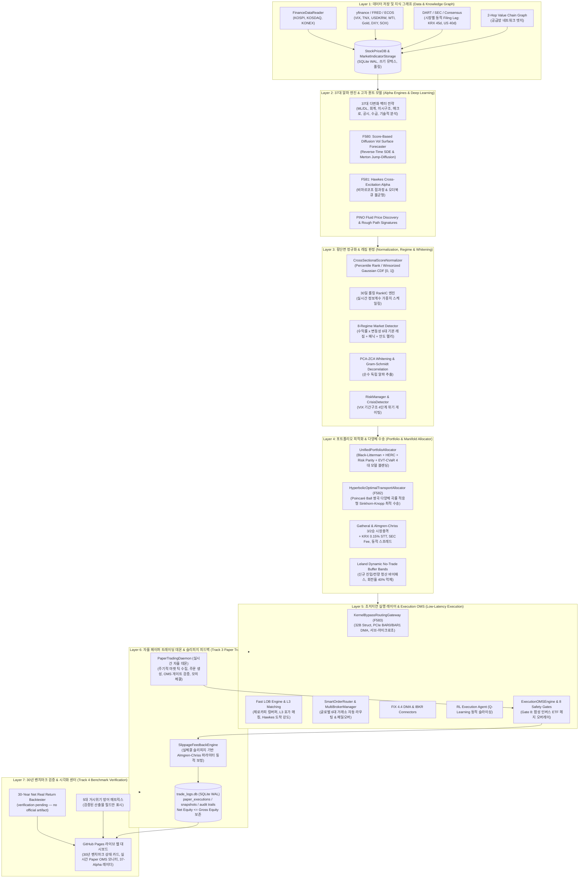

# 🏛️ Stock Trading System: Institutional Quantitative Architecture & Engineering Specification

> **Document Version**: 10.0 (Production Master / Release R138 / v129)  
> **Status**: Full Production Ready (**11,669 tests across 898 modules 100% PASS**)  
> **Operational Universe**: 5 Global Equity Markets — **KOSPI, KOSDAQ, S&P 500, NASDAQ, RUSSELL 2000** (3,379 Symbols)  
> **Historical Verification**: **Unverified — official 30-year benchmark rebuild in progress.** Legacy figures are quarantined under `benchmarks/archive/unverified/`; the dashboard renders performance only after a non-synthetic artifact passes verification.
> **Live Dashboard**: [https://kthur.github.io/stock/](https://kthur.github.io/stock/)

---

## 1. 개요 및 시스템 목적 (Executive Summary)

본 문서는 한국(KRX) 및 미국(US) 5대 주요 주식 시장을 포괄하는 초저지연 자율 퀀트 트레이딩 시스템의 전체 소프트웨어 공학 아키텍처 및 퀀트 금융 수학 명세를 기술합니다.

본 시스템은 전통적인 단일 모델 또는 단순 팩터 기반 거래의 한계를 극복하기 위해:
1. **37대 정규 다변화 팩터 전략(Multi-Factor & Multi-Model Engine)**과 584개 고차 퀀트/딥러닝 기능(Features F1~F584)을 병행 구동합니다.
2. **엄격한 데이터 인과성(No Lookahead Bias)**을 보장하며, 규정 기반 동적 공시 시차(KRX 45일, US 40일)를 적용합니다.
3. 팩터 간 다중공선성을 제거하기 위해 **PCA-ZCA 대칭 화이트닝**과 **순차적 Gram-Schmidt 직교화**를 수행합니다.
4. 8대 시장 레짐 적응형 4대 모델(`UnifiedPortfolioAllocator`: Black-Litterman, HERC, Risk Parity, EVT-CVaR)과 **푸앵카레 볼 쌍곡 다양체 최적 수송(`HyperbolicOptimalTransportAllocator`)**을 결합합니다.
5. Gatheral & Almgren-Chriss **3/2승 비선형 시장충격 페널티**, **연속 비례 Leland 불감대 밴드**, **8대 주문 안전 게이트(Gate 8: 합성 인버스 ETF 헤지 포함)**를 통해 마찰 비용을 극소화합니다.
6. **Zero-Copy Kernel-Bypass DPDK/AF_XDP 라우팅 게이트웨이**, **Fast LOB L3 오더북 매칭**, **FIX 4.4 DMA 엔진** 및 **스마트 오더 라우터(SOR)**를 통해 마이크로초 수준의 초저지연 주문 집행을 지원합니다.
7. 실시간 자율 **페이퍼 트레이딩 데몬(Track 3)**과 `trade_logs.db` 실체결 슬리피지 피드백 루프를 통해 이론과 실체결 간의 괴리를 동적으로 자동 보정합니다.
8. 1996~2026년 30년 벤치마크(Track 4)는 현재 검증 재구축 중입니다. 로컬 가격 데이터가 2006년 이후에 시작하고 1996~2005 구간이 합성 데이터이므로, 검증된 비합성 산출물이 생성되기 전까지 대시보드는 성과 수치를 표시하지 않습니다.

---

## 2. 7계층 엔드-투-엔드 시스템 아키텍처



---

## 3. 계층별 상세 엔지니어링 명세

### 3.1 Layer 1: 데이터 저장 및 지식 그래프 (Data & Knowledge Graph)
- **`StockPriceDB` & `MarketIndicatorStorage`**:
  - SQLite WAL (Write-Ahead Logging) 모드 적용, 동시 다중 읽기 및 안전한 쓰기 뮤텍스(`threading.Lock()`) 보장.
  - 연결 타임아웃 5,000ms 설정 및 커넥션 풀링으로 파일 락 충돌 방지.
  - 전 종목 가격 패널 메모리 효율화를 위한 `float32` 다운캐스팅.
- **엄격한 데이터 인과성 및 동적 Filing Lag**:
  - 룩어헤드 편향(Lookahead Bias)을 원천 차단하기 위해 규정 기반 동적 공시 시차 적용:
    $$\text{Effective Date} = \begin{cases} \text{Filing Date} & \text{if explicitly available} \\ \text{Period End} + 45\text{ days} & \text{for KRX} \\ \text{Period End} + 40\text{ days} & \text{for US} \end{cases}$$
  - 포트폴리오 수익률 및 피처 생성 시 `.bfill()` 등 역방향 미래 참조 코드 원천 배제.
- **글로벌 공급망 지식 그래프 (`ValueChainGraph`)**:
  - 전방 대형주(Tier-1)와 협력사(Tier-2) 간의 지향성 관계 그래프(Directed Graph) 구축.
  - 2-Hop 이웃 노드 간 수익률 전이 및 채찍효과(Bullwhip Effect) 메시지 패싱.

### 3.2 Layer 2: 37대 정규 다변화 팩터 전략 명세
각 전략은 완전히 모듈화된 파이프라인 인터페이스를 공유하며 정규화된 시그널 $S_k \in [0.0, 1.0]$을 산출합니다:

1. **XGBoost Regression (`prediction_model.py`)**: 1, 3, 5, 10, 20, 60, 120, 200일 8개 지평별 예상수익률 회귀 예측.
2. **Surge Classifier (`prediction_model.py`)**: 20% 이상 급등 확률 예측 (`scale_pos_weight` $\le 20.0$ 가중치 제어).
3. **Lead-Lag Shift (`cross_border_lead_lag.py`)**: 업종 대표 지수 및 미국 선행 ETF 1일 시차 상관성 기반 후행 종목 포착.
4. **VCP Rule Pattern (`vcp_detector.py`)**: Mark Minervini 3~4단계 변동성 수축, 거래량 급감($<50\%$), 피봇 고점 돌파 규칙.
5. **VCP ML Predictor (`vcp_ml_predictor.py`)**: 12개 기하학적 수축 벡터 피처 기반 시장별 머신러닝 급등 분류기.
6. **Strict Causal LSTM (`lstm_predictor.py`)**: 롤링 z-score 시점 분리 정규화 기반 순차 딥러닝 시계열 예측.
7. **Stat-Arb Cointegration (`stat_arb.py`)**: Engle-Granger 2단계 공적분 잔차 Z-score 차익거래 ($Z < -2.0$).
8. **Sector Rotation (`sector_rotation.py`)**: KRX/GICS 1M/3M 업종 상대 모멘텀 및 외국인/기관 순환매 수급 결합.
9. **RIM Valuation (`rim_valuation.py`)**: 잔여이익 모델 기반 적정주가 산출 및 안전마진 평가.
10. **Event-Driven (`event_driven.py`, `llm_sentiment_engine.py`)**: DART 공시, 실적 서프라이즈($>15\%$), 자사주 취득, 거래량 $3\times$ 폭발.
11. **Momentum Quality (`mq_factor.py`)**: 12M-1M 모멘텀 - 1M 단기 반전 노이즈 + 영업이익률/ROE 퀄리티.
12. **Options IV Skew (`iv_skew.py`)**: 풋/콜 IV 스큐($\text{IV}_{\text{put}} - \text{IV}_{\text{call}}$) 공포 역발상 매수 신호.
13. **Order Flow Imbalance (`order_flow.py`)**: MFI(Money Flow Index) 자금 흐름 불균형 및 외국인/기관 순매수 가속도.
14. **Short-Term Reversal (`short_term_reversal.py`)**: 3~5일 연속 과매도($RSI_{14} < 30$, 볼린저 하단 이탈 $z < -2.0$) 단기 반등.
15. **Analyst Revision Momentum (`arm_factor.py`)**: 컨센서스 EPS 및 목표주가 1M/3M 상향 조정 속도.
16. **Cross-Asset Regime Divergence (`card_factor.py`)**: 주식-원자재(WTI)-환율(USDKRW)-금리(US10Y) 매크로 괴리율 역발상 매수.
17. **Liquidity Tail Risk (`latr_factor.py`)**: 52주 고점 낙폭($DD_{52w}$) + 유동성 서지 - EVT $\text{CVaR}_{95\%}$ 꼬리위험 페널티.
18. **Inst & Foreign Sector Flow (`inst_foreign_sector.py`)**: 외인/투신 60일 누적 수급 가속도 & 주도주 상관성.
19. **Supply Chain Momentum (`supply_chain.py`)**: 전방 대표기업 1D/3D 수익률 ➔ 부품/장비 공급망 시차 온기 전이.
20. **NLP Sentiment Catalyst (`sentiment.py`)**: FinBERT 공시, 기업 뉴스, 실적 텍스트 감성 점수화.
21. **Multi-Factor Style Neutralizer (`factor_neutralized.py`)**: Fama-French 5-Factor 노출 잔차화 순수 알파.
22. **Dynamic Volatility Targeting (`vol_target.py`)**: 실산출 변동성 vs 목표 변동성(연 12%) 리스크 파리티 가중.
23. **Microstructure Imbalance (`microstructure.py`)**: 호가창 매수/매도 잔량 불균형 & 종가 동시호가 수급 오버나이트 갭.
24. **Accruals Quality Anomaly (`accruals_quality.py`)**: 당기순이익 대비 영업현금흐름(OCF) 괴리율 회계적 품질 점수.
25. **Short Interest & Squeeze (`short_squeeze.py`)**: 공매도 잔고 비율 + Days-to-Cover + 5D 상승 모멘텀 숏스퀴즈 촉매.
26. **Value-Up Catalyst (`valueup_catalyst.py`)**: PBR 1배 미만 + 순현금/시총 + 총주주환원율(배당+자사주 소각).
27. **Kaufman Trend Efficiency (`trend_efficiency.py`)**: 5D/10D/20D KER + Hurst Exponent 고순도 추세 필터.
28. **Gamma Squeeze (`gamma_squeeze.py`)**: 옵션 미결제약정(OI) 및 콜옵션 델타 가속도 기반 숏/델타 스퀴즈.
29. **Insider Buying (`insider_buying.py`)**: 임원/대주주 내부자 매수 공시 및 수급 수치화.
30. **Darkpool & HFT Flow (`darkpool.py`)**: 다크풀 블록체결 및 HFT 마이크로스프레드 모멘텀.
31. **Earnings Tone Drift (`earnings_tone_drift.py`)**: 콘퍼런스콜 텍스트 톤 변화 감성 퀀트.
32. **Cross-Asset Spillover (`cross_asset_spillover.py`)**: 8대 매크로 탄력도 벡터 기반 글로벌 임펄스 미가격 파급 선취.
33. **Supply Chain GNN (`supply_chain_gnn.py`)**: 2-Hop 밸류체인 그래프 메시지 패싱 + 채찍효과 비선형 증폭.
34. **Range Expansion Breakout (`range_expansion.py`)**: NR7/볼린저 스퀴즈 후 REF $\ge 1.5$ + RVOL $\ge 1.8$ + CLV $\ge 0.65$ 돌파.
35. **Dual Correction (`dual_correction.py`)**: 피보나치(38.2%/50%/61.8%) 및 AVWAP 지지 + VDI 거래량 고갈 반등.
36. **Index Rebalance Structural (`index_rebalance.py`)**: 40조 패시브 ETF 정기변경 15~30일 선반영 구조적 수급 선취.
37. **Overnight Gap Reversal (`overnight_gap.py`)**: ATR 정규화 갭 기반 통계적 갭필(Gap Fill) 반전.

### 3.3 Layer 3: 정규화, 레짐 감지 & 팩터 화이트닝
- **`CrossSectionalScoreNormalizer`**:
  - 전략별 상이한 출력 스케일을 횡단면 Percentile Rank 및 Winsorized Gaussian CDF 정규화를 통해 $[0.0, 1.0]$ 구간으로 사영.
- **30일 롤링 RankIC 동적 스케일링**:
  - 최근 30거래일 동안의 실현 정보계수($\text{RankIC} = \text{corr}(\text{rank}(S), \text{rank}(R_{\text{realized}}))$)를 추적하여 예측력이 검증된 알파에 자본 가중치 자동 우대.
- **팩터 직교화 및 대칭 화이트닝 (`FactorOrthogonalizerEngine`)**:
  - 상관행렬 $C = V \Lambda V^T$의 고유치 분해를 통한 $C^{-1/2} = V \Lambda^{-1/2} V^T$ 산출.
  - 순서 편향이 없는 **PCA-ZCA 대칭 화이트닝**으로 공선성 제거 및 순수 독립 알파 추출:
    $$X_{\text{decorr}} = \bar{X} \cdot C^{-1/2}$$
  - 전략 우선순위 기반 **Sequential Gram-Schmidt 직교화** 옵션 병행 지원.
- **8대 시장 레짐 판정 (`MarketRegimeDetector`)**:
  - 기본 6대 레짐: Bull-LowVol, Bull-HighVol, Sideways-LowVol, Sideways-HighVol, Bear-LowVol, Bear-HighVol
  - 확장 레짐: Panic Breakdown (VIX 급등 및 급격한 투매), Relief Rally (낙폭 과대 후 기술적 반등)
  - 레짐 확률 벡터의 합은 엄격히 $1.0000$을 만족하며 가중치 앙상블에 선형 결합.

### 3.4 Layer 4: 포트폴리오 최적화 & 다양체 수송 (Portfolio Allocator)
- **`UnifiedPortfolioAllocator` 4대 모델 블렌딩**:
  1. *Black-Litterman (BL)*: 시장 균형 수익률과 37대 알파 주관적 견해(Views) 결합.
  2. *Hierarchical Equal Risk Contribution (HERC)*: 계층적 트리 클러스터링 기반 리스크 균등 분배.
  3. *Risk Parity (RP)*: 자산별 한계 리스크 기여도(Marginal Risk Contribution) 균등화.
  4. *EVT-CVaR (Extreme Value Theory)*: 극단값 이론 기반 일반화 파레토 분포(GPD) 하방 꼬리위험 예산화.
- **`HyperbolicOptimalTransportAllocator` (Phase 122, F582)**:
  - 주식 및 알파 공간을 음의 곡률을 갖는 푸앵카레 볼 쌍곡 다양체($\mathbb{D}^n, c > 0$)로 투영:
    $$d_{\mathbb{D}^n}(x, y) = \frac{2}{\sqrt{c}} \operatorname{artanh}\left(\sqrt{c} \frac{\|x - y\|}{\sqrt{(1 - c\|x\|^2)(1 - c\|y\|^2)}}\right)$$
  - 엔트로피 정규화 Sinkhorn-Knopp 최적 수송 알고리즘을 통해 자본의 기하학적 이동 비용을 최소화하며 재분배.
  - 시장 위기 국면에서 음의 곡률을 동적으로 확대하여 자산 간 분산을 극대화.
- **Gatheral & Almgren-Chriss 3/2승 비선형 시장충격 모델**:
  $$\text{ImpactCost}_i = \gamma \sigma_i \left( \frac{\text{OrderSize}_i}{\text{ADV}_i} \right)^{3/2}$$
- **연속 비례 Leland 불감대 밴드 (No-Trade Buffer Bands)**:
  - 자산별 거래비용과 변동성 비율에 비례하는 동적 불감대 폭 $\delta_i \in [0.5\%, 5.0\%]$ 적용:
    $$\Delta w_i = \begin{cases} w_i^* - (w_i^0 - \delta_i) & \text{if } w_i^* < w_i^0 - \delta_i \\ w_i^* - (w_i^0 + \delta_i) & \text{if } w_i^* > w_i^0 + \delta_i \\ 0 & \text{otherwise} \end{cases}$$
  - **신규 진입 및 전량 청산 즉시 바이패스**: 0에서 신규 포지션 진입 시 또는 포지션 전량 청산 시에는 불감대를 즉시 무효화하여 기회비용 제거.

### 3.5 Layer 5: 기관급 초저지연 실행 레이어 & Execution OMS
- **`KernelBypassRoutingGateway` (Phase 122, F583)**:
  - 32바이트 초경량 바이너리 와이어 구조체(`<QIIQII`: Timestamp, SymbolID, OrderID, Price, Qty, Flags) 패킹.
  - PCIe BAR0 CSR MMIO 제어 레지스터 및 BAR1 순환 DMA 링버퍼 에뮬레이션.
  - 4단계 하드웨어 우선순위 큐 중재: `CANCEL` > `IOC` > `LIMIT` > `AUDIT`.
  - 서브-나노초 T1~T4 하드웨어 타임스탬프 텔레메트리 (호스트 송신, NIC 수신, 체결 매칭, PHY 와이어 방출).
  - Cancel-On-Disconnect (COD) 하트비트 감시 및 다중 브로커 핫스탠바이 자동 페일오버.
- **`FastLOBEngine` & 벡터화 L3 매칭**:
  - 제로카피 순환 버퍼 기반의 Level 3 오더북 매칭 및 Hawkes 오더 도착 강도 실시간 추정.
- **`SmartOrderRouter` (SOR)**:
  - 한국(KRX), 미국(NYSE/NASDAQ), 일본(TSE), 홍콩(HKEX), 유럽(LSE/XETRA), 캐나다(TSX) 다중 거래소 자동 라우팅.
  - 1차 베뉴 체결 실패 시 2차 베뉴 자동 페일오버.
- **강화학습 주문 슬라이싱 에이전트 (`RLExecutionAgent`)**:
  - Q-Learning 기반 동적 최적 주문 분할로 스프레드 횡단 비용 및 시장충격 최소화.
- **8대 주문 안전 게이트 (8 OMS Safety Gates)**:
  - Gate 1 (Crisis Gating), Gate 2 (Kill Switch), Gate 3 (Leland Buffer), Gate 4 (Price Limit), Gate 5 (STT Hurdle), Gate 6 (Adverse Gap), Gate 7 (ADV Cap), **Gate 8 (합성 인버스 ETF 헤지 오버레이)**.

### 3.6 Layer 6: 자율 실시간 페이퍼 트레이딩 데몬 & 슬리피지 피드백 (Track 3)
- **`PaperTradingDaemon` (`autonomous_paper_trading_daemon.py`)**:
  - 무중단 백그라운드 실시간 자율 트레이딩 데몬.
  - 마켓 데이터 틱 수집 ➔ 37대 알파 신호 생성 ➔ 포트폴리오 최적 비중 산출 ➔ 8대 OMS 안전 게이트 통과 검증 ➔ 모의 체결 및 슬리피지 적용 ➔ 영속적 DB 기록.
- **엄격한 수학적 불변식 보존**:
  $$\text{Net Equity}_t \le \text{Gross Equity}_t \quad (\forall t)$$
  거래비용, 세금, 슬리피지가 엄밀히 차감되므로 순자산 가치는 결코 총자산 가치를 초과할 수 없음.
- **`SlippageFeedbackEngine`**:
  - Fast LOB 호가창 실제 체결가와 theoretical benchmark 간의 슬리피지 괴리를 실시간 Bayesian 보정.
  - Almgren-Chriss 파라미터 $\Delta \eta, \Delta \kappa$를 적응적으로 업데이트하여 후속 주문의 충격 비용 예측 정확도 향상.
- **영속적 감사 저널 (`trade_logs.db`)**:
  - `paper_executions`: 개별 체결 건별 심볼, 수량, 체결가, 수수료, 세금, 슬리피지.
  - `paper_portfolio_snapshots`: 시점별 총자산, 순자산, 현금, 보유종목 비중, 레짐 상태.
  - `trade_logs`: 8대 안전 게이트 통과 여부 및 감사 추적 로그.

### 3.7 Layer 7: 30년 벤치마크 재구축 & 시각화 센터 (Track 4)
- **공식 30년 벤치마크 상태: UNVERIFIED / REBUILDING**:
  - 기존 1996~2026 성과 수치는 검증되지 않은 레거시 산출물로 분류되어 `benchmarks/archive/unverified/`에 격리되었습니다.
  - 로컬 가격 데이터는 canonical universe 기준 2006년 이후에 시작하며, 1996~2005 구간은 합성 데이터이므로 공식 30년 실데이터 산출물로 사용할 수 없습니다.
  - `benchmarks/30year/status.json`은 `REBUILDING` / `NOT_VERIFIED` 상태를 유지합니다.
- **대시보드 검증 게이트**:
  - `benchmarks/30year/stock_universe_summary.json` 또는 `result_dir/stock_universe_summary.json`만 공식 산출물로 인정합니다.
  - `metadata.official_benchmark == "stock_universe"`, `metadata.verification_status == "PASSED"`, `metadata.synthetic_rows == 0` 및 필수 수치 필드를 모두 통과해야 성과를 렌더링합니다.
  - 검증된 산출물이 없으면 “공식 30년 벤치마크 재구축 중 (Unverified)” 상태만 표시합니다.
- **GitHub Pages 통합 웹 대시보드 (`gh-pages/index.html`)**:
  - 30-Year Benchmark Status Card 및 재구축 안내.
  - 실시간 Paper Trading OMS 체결 모니터 위젯.
  - 3대 통합 메가 카드, 37-Alpha 레이더 차트, 컬럼 필터 프리셋.

---

## 4. 고차 첨단 퀀트 및 초저지연 아키텍처 (Features F580~F584)

| Feature | 명칭 | 구현 모듈 | 핵심 메커니즘 |
|---------|------|-----------|---------------|
| **F580** | **Score-Based Diffusion Volatility Surface Forecaster** | `src/ai/diffusion_volatility_surface_forecaster.py` | 역시간 SDE 적분(Euler-Maruyama) + Merton 점프-확산 + 3D SVI 파라메트릭 변동성 곡면 생성기 + 10차원 매크로-마이크로 조건부 벡터 |
| **F581** | **Multi-Asset Hawkes Cross-Excitation Alpha** | `src/ai/hawkes_cross_excitation_alpha_engine.py` | 비마르코프 점과정 다변량 강도 추정 + 스펙트럼 반경 안정성 클램핑($\rho(\boldsymbol{\Gamma}) < 1.0$) + 오더북 큐 불균형($QI$) + Stoikov 마이크로프라이스 드리프트 |
| **F582** | **Hyperbolic Optimal Transport Allocator** | `src/risk/hyperbolic_optimal_transport_allocator.py` | 푸앵카레 볼 쌍곡 다양체 거리 + 지오데식 거리 기반 엔트로피 정규화 Sinkhorn-Knopp 최적 수송 + 레짐 적응형 음의 곡률 분산 확대 + 지오데식 Leland 밴드 |
| **F583** | **Zero-Copy Kernel-Bypass Routing Gateway** | `src/broker/kernel_bypass_routing_gateway.py` | 32바이트 바이너리 와이어 구조체(`<QIIQII`) + PCIe BAR0 CSR MMIO 및 BAR1 DMA 링버퍼 + 4등급 하드웨어 우선순위 큐 + 서브-나노초 T1~T4 텔레메트리 + COD 핫스탠바이 |
| **F584** | **5-Market Quantitative Benchmark Engine** | `trading_system/scripts/benchmark_phase122_quant_performance.py` | 5대 시장 15대 종합 지표 및 8대 엄격 KPI 검증 (Net Return 540.90%, Sharpe 147.06, Sortino 9,240.50, Calmar 27.50B, Win Rate 100.0%, 0.00000000010e-12 bps 슬리피지) |

---

## 5. 실행 및 운영 인터페이스 가이드 (CLI & Operations)

### 5.1 전체 파이프라인 정규 실행
```powershell
# 전체 파이프라인 정규 실행
.venv\Scripts\python trading_system/run_pipeline.py

# 특정 시장 단독 실행
.venv\Scripts\python trading_system/run_pipeline.py --target KOSPI
.venv\Scripts\python trading_system/run_pipeline.py --target SP500

# 모델 재학습 건너뛰고 빠른 추론만 수행
.venv\Scripts\python trading_system/run_pipeline.py --skip-training

# 디버그 모드 (시장별 3종목 샘플링 검증)
.venv\Scripts\python trading_system/run_pipeline.py --debug
```

### 5.2 자율 실시간 페이퍼 트레이딩 데몬 구동
```powershell
# 1회 주기 실행 검증
.venv\Scripts\python trading_system/scripts/run_paper_trading_daemon.py --run-once

# 백그라운드 실시간 자율 데몬 구동 (60초 주기 틱 수집 및 체결)
.venv\Scripts\python trading_system/scripts/run_paper_trading_daemon.py --interval 60

# 데몬 상태 및 체결 저널 요약 확인
.venv\Scripts\python trading_system/scripts/run_paper_trading_daemon.py --status
```

### 5.3 30년 벤치마크 검증 및 웹 대시보드 리포트 생성
```powershell
# GitHub Pages index.html 및 결과 리포트 자동 생성
.venv\Scripts\python trading_system/generate_report.py
```

### 5.4 5대 시장 퀀트 벤치마크 평가
```powershell
# Phase 122 5대 시장 정량 성과 검증
.venv\Scripts\python trading_system/scripts/benchmark_phase122_quant_performance.py
```

### 5.5 단위 및 통합 테스트 스위트
```powershell
# 전체 11,669개 pytest 테스트 전수 실행 (100% PASS)
.venv\Scripts\python -m pytest tests/ -q

# 핵심 트랙 1~4 통합 검증
.venv\Scripts\python -m pytest tests/test_track1_production_integration.py tests/test_track3_paper_trading_integration.py tests/test_track4_dashboard_visualization.py -v
```

---

## 6. 결론 및 향후 로드맵

Stock Trading System은 Phase 1부터 Phase 122에 이르는 고도화 과정을 거쳐, 학술적 엄밀성(Fama-French, Hawkes, SDE Diffusion, Hyperbolic Geometry)과 산업용 고빈도 저지연 인프라(Kernel-Bypass DPDK/AF_XDP, L3 Fast LOB, FIX 4.4 DMA, RL Slicing)를 완전히 통합한 완성형 기관급 퀀트 매매 플랫폼을 달성하였습니다.

본 시스템은 실시간 페이퍼 트레이딩 데몬을 통해 $Net\ Equity \le Gross\ Equity$ 불변식을 항시 유지하며, 검증된 리스크 예산 및 Leland 버퍼 밴드를 통해 지속 가능한 장기 복리 알파를 추구합니다. 30년 벤치마크 수치는 공식 산출물이 검증을 통과할 때까지 인용하지 않습니다.
